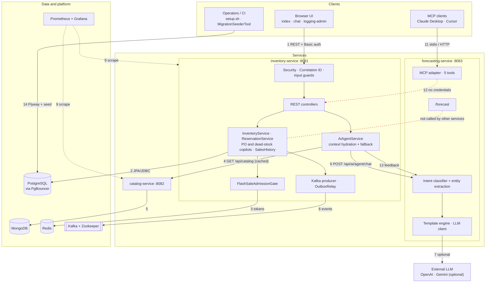
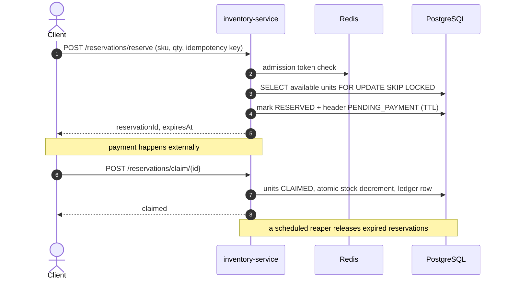

<!--
  Copyright (c) 2026 Vivek Umrao.

  Licensed under the Apache License, Version 2.0 (the "License");
  you may not use this file except in compliance with the License.
  You may obtain a copy of the License at

      http://www.apache.org/licenses/LICENSE-2.0

  Unless required by applicable law or agreed to in writing, software
  distributed under the License is distributed on an "AS IS" BASIS,
  WITHOUT WARRANTIES OR CONDITIONS OF ANY KIND, either express or implied.
  See the License for the specific language governing permissions and
  limitations under the License.
-->

<p align="center">
  <picture>
    <source media="(prefers-color-scheme: dark)" srcset="docs/assets/logo/logo-dark.svg">
    <source media="(prefers-color-scheme: light)" srcset="docs/assets/logo/logo-light.svg">
    
  </picture>
</p>

# Smart Inventory Management System

[](https://openjdk.org/)
[](https://spring.io/projects/spring-boot)
[](https://fastapi.tiangolo.com/)
[](https://gradle.org/)
[](docs/PODMAN_MIGRATION.md)
[](https://docs.docker.com/compose/)
[](infra/helm/smart-inventory)
[](LICENSE)
[](#-project-status)

A polyglot microservices reference platform for **real-time stock management**, **flash-sale-safe reservations**, and an **AI inventory assistant**. Java (Spring Boot) services own the transactional core; a Python (FastAPI) service provides natural-language answers and forecasting helpers.

> **Where it stands:** a strong reference architecture and pilot-ready base, not yet a drop-in replacement for an ERP or WMS. The [Project Status](#-project-status) and [Known Limitations](#-known-limitations) sections say exactly what is solid and what is not, so you can decide quickly whether it fits.

---

## Contents

[The problem](#-the-problem-it-solves) · [Status](#-project-status) · [Architecture](#-architecture-at-a-glance) · [Services and ports](#-services-and-ports) · [Quick start](#-quick-start) · [Web interfaces](#-web-interfaces) · [Key flows](#-key-flows) · [Limitations](#-known-limitations) · [Security checklist](#-before-you-go-to-production) · [Roadmap](#-roadmap) · [Documentation](#-documentation) · [License](#-license)

---

## 🎯 The problem it solves

| Real-world pain | What this project gives you |
| :--- | :--- |
| **Overselling during spikes**: two checkouts claim the last unit | Idempotent, non-blocking reservations (`FOR UPDATE SKIP LOCKED`) with TTL expiry and an atomic claim step |
| **Slow, spreadsheet-driven replenishment** | Low-stock detection, a human-approvable draft purchase order, and a supplier/PO lifecycle (draft, submit, approve, receive) |
| **Cash tied up in dead stock** | A rule-based advisor that flags slow movers and suggests markdowns or transfers |
| **Answers locked behind analysts** | A chat assistant that answers stock, value, and reorder questions and exports tables to Excel, Word, or PDF |
| **Operating a distributed system blind** | Correlation IDs, Prometheus metrics, SLO alert rules, Grafana dashboards, runtime log-level control |

**Good fit:** learning and interview showcase, a base for a reservation service, an internal pilot for a single-warehouse business.
**Not yet a fit:** replacing an ERP/WMS, committing real purchasing money on its forecasts, multi-database or multi-warehouse production use. See [Known Limitations](#-known-limitations).

---

## 📊 Project status

**✅ Implemented and working as described · 🟡 Partial or simplified · 📝 Designed or documented, not implemented**

| Capability | Status | Notes |
| :--- | :---: | :--- |
| Stock items, adjustments, immutable transaction ledger | ✅ | Single warehouse per SKU |
| Reservations: reserve, claim, release, TTL expiry, idempotency keys | ✅ | PostgreSQL. Limits: 50 units per reservation, 500-unit pool |
| Purchase orders and suppliers (draft, submit, approve, receive) | ✅ | REST only; no UI screen yet |
| Product catalog (MongoDB), dynamic attributes | ✅ | GET endpoints are public |
| RBAC users and roles, BCrypt, HTTP Basic | 🟡 | Seeded default passwords; no SSO; see [security checklist](#-before-you-go-to-production) |
| Kafka stock events via outbox | 🟡 | Events are also sent directly, so duplicates are possible; the only consumer logs |
| Redis flash-sale admission gate | 🟡 | Fails open if Redis is unavailable |
| AI chat: intent classifier + templated answers | ✅ | Offline-capable; 15 intents |
| AI chat: optional OpenAI / Gemini mode | 🟡 | One prompt with up to 100 records; output is not verified against data |
| AI context for large catalogs | 🟡 | Uses a sample of up to 250 SKUs; portfolio summary is sent but not yet used by the Python agent |
| Demand forecasting (`/forecast`) | 🟡 | Linear trend plus weekly factors. Not called by the copilots or chat |
| "Agentic" tool use | 🟡 | MCP adapter exposes 5 tools; the chat path does not use them yet |
| Feedback learning | 🟡 | Saved in PostgreSQL; the Python agent keeps it in memory with exact-match override |
| pgvector similarity learning (ADR 0010) | 📝 | Not implemented |
| Multi-location stock positions, bucketed counters (ADR 0011) | 📝 | Schema and entities exist; ADR status is *Proposed*; UI and AI read single-location data |
| Support for MySQL, Oracle, SQL Server, DB2 | 📝 | Dialect classes exist, but the reservation query and migrations are PostgreSQL-specific |
| Observability: metrics, alerts, dashboards, correlation IDs | ✅ | No distributed tracing yet |
| Packaging: Compose, Podman pod, Helm (HPA, PDB, ingress) | ✅ | |
| ERP / POS / e-commerce integrations, barcode scanning | 📝 | CSV import only |

---

## 🏛️ Architecture at a glance

Numbers match the interaction table below. Dashed red lines mark paths with known gaps.



| # | From → to | Channel | Notes |
| :-: | :--- | :--- | :--- |
| 1 | Browser → inventory-service | REST, HTTP Basic | Pages are public; APIs need credentials |
| 2 | inventory → PostgreSQL | JPA + JDBC via PgBouncer | Ledger, reservations, POs, users, feedback |
| 3 | inventory → Redis | Token decrement | Flash-sale admission gate |
| 4 | inventory → catalog | `GET /api/catalog` | TTL cache with fallback so prices do not drop to $0 |
| 5 | catalog → MongoDB | Spring Data Mongo | Product documents |
| 6 | inventory → forecasting | `POST /api/ai/agent/chat` | Query + sampled SKUs + catalog; Java fallback if it fails |
| 7 | forecasting → external LLM | HTTPS, optional | Only when an API key is set |
| 8 | inventory → Kafka | Outbox relay (and direct send) | Topic `inventory-stock-events` |
| 9 | Prometheus → services | `/actuator/prometheus` | Grafana reads Prometheus |
| 11 | MCP clients → forecasting | stdio or `POST /mcp/tools/execute` | No authentication yet |
| 12 | MCP adapter → inventory | REST | Needs service credentials (known gap) |
| 13 | inventory → forecasting | `POST /api/ai/feedback` | Also stored in PostgreSQL |
| 14 | Operators → PostgreSQL | Flyway + seeder jar | Out-of-band schema and seed data |

A standalone interactive version of this diagram, with all modules, is available in the architecture review materials. Deeper detail: [docs/ARCHITECTURE.md](docs/ARCHITECTURE.md) and [docs/SYSTEM_CONTAINER_ARCHITECTURE.md](docs/SYSTEM_CONTAINER_ARCHITECTURE.md).

---

## 🚀 Services and ports

| Service | Stack | Port | Storage / messaging | Responsibilities |
| :--- | :--- | :---: | :--- | :--- |
| **inventory-service** | Java 17/21, Spring Boot 3.4.1, Spring Security | 8081 | PostgreSQL, Redis, Kafka | Stock, reservations, purchase orders, users, AI orchestration, hosts the web UI |
| **catalog-service** | Java 17/21, Spring Boot 3.4.1 | 8082 | MongoDB | Products, categories, pricing, attributes |
| **forecasting-service** | Python 3.11, FastAPI, scikit-learn | 8083 | In-memory + joblib model | Intent classification, answer synthesis, optional LLM, `/forecast`, MCP tools |
| **integration-tests** | JUnit 5, Testcontainers | n/a | H2, Mongo | Cross-service tests |
| **Platform** | PgBouncer, Prometheus, Grafana, Kafka, Zookeeper | 6432, 9090, 3000, 9092, 2181 | n/a | Pooling, metrics, dashboards, events |

---

## ⚡ Quick start

Requires Podman or Docker (run containers inside WSL on Windows).

```bash
# Fresh environment: tears down, builds, starts everything, seeds sample data
./scripts/setup.sh fresh              # PostgreSQL (the supported database)

# Day-to-day
./scripts/setup.sh up postgres        # start existing environment
./scripts/setup.sh reload all         # rebuild services without touching databases
./scripts/setup.sh seed               # re-seed sample data
./scripts/setup.sh destroy            # stop, keep volumes
./scripts/setup.sh clean              # wipe containers, volumes, images, .env
```

> `fresh mysql | mssql | oracle | db2` exist as options, but only PostgreSQL is currently supported end to end (see [limitations](#-known-limitations)).

### Default accounts (development only)

| User | Role | Default password |
| :--- | :--- | :--- |
| `admin` | `ROLE_ADMIN` | `admin123` |
| `manager` | `ROLE_MANAGER` | `manager123` |
| `operator` | `ROLE_ENTRY_OPERATOR` | `operator123` |
| `viewer` | `ROLE_USER` | `viewer123` |

Override with `APP_SECURITY_DEFAULT_ADMIN_PASSWORD`, `…_MANAGER_PASSWORD`, `…_OPERATOR_PASSWORD`, `…_VIEWER_PASSWORD`. **Change these before exposing the service anywhere.**

### Optional: cloud LLM mode

Set `OPENAI_API_KEY` (or `LLM_API_KEY`, with `LLM_MODEL`) or `GEMINI_API_KEY`. Without a key the assistant runs fully offline. With a key, up to 100 inventory records are sent to the provider; make sure that is acceptable for your data.

---

## 🌐 Web interfaces

| Page | URL | What it is |
| :--- | :--- | :--- |
| Operations Hub | http://localhost:8081/ | Inventory ledger (add, adjust, delete) and the reservation console |
| AI Assistant | http://localhost:8081/chat.html | Chat with quick prompts, PO draft and dead-stock copilots, Excel/Word/PDF export |
| Logger Admin | http://localhost:8081/logging-admin.html | Runtime log levels (admin only) |
| Inventory API docs | http://localhost:8081/swagger-ui.html | Use the accounts above |
| Catalog API docs | http://localhost:8082/swagger-ui.html | |
| Forecasting API docs | http://localhost:8083/docs | |
| Grafana / Prometheus | http://localhost:3000 / http://localhost:9090 | Dev defaults; change before sharing |

The UI is desktop-first. Chat tables are not yet responsive on phones.

---

## 🔄 Key flows

### Reservation (flash-sale safe)



### AI chat

1. The UI posts the question to inventory-service.
2. Java loads a SQL sample or summary plus the catalog cache.
3. forecasting-service classifies intent (keyword rules first, then the trained model) and extracts SKU, warehouse, category.
4. With an API key the LLM answers; otherwise the template engine does.
5. Answer and risk level return; the UI renders markdown tables and offers exports.

---

## ⚠️ Known limitations

Stated plainly so you can plan around them.

- **PostgreSQL only in practice.** Reservation locking SQL and the first migration use PostgreSQL syntax.
- **Forecasts are simple.** Linear trend with weekly factors, no accuracy tracking. Treat them as indicative, not as purchasing authority.
- **PO copilot is rule-based.** It uses a 30-day sales sum and a fixed 7-day lead time; it ignores supplier terms, minimum order quantities, and open orders.
- **"Sales" are inferred from negative stock movements**, so damage or transfers can look like demand.
- **Valuation uses catalog price**, not cost layers, so it is not accounting-grade.
- **AI answers over large catalogs use a sample** (up to 250 SKUs). In LLM mode, numbers in the reply are not verified against the data.
- **Events can be duplicated** (direct send plus outbox relay), and nothing downstream consumes them yet.
- **Single warehouse per SKU** in the UI and AI layers.
- **Operational weight.** The full stack (PostgreSQL, PgBouncer, MongoDB, Redis, Kafka, Zookeeper, Prometheus, Grafana) is heavy for a small deployment.
- **No load-test results are published.** Throughput figures in the ADRs are design estimates.

---

## 🔐 Before you go to production

- [ ] Replace seeded passwords and set `SPRING_JPA_HIBERNATE_DDL_AUTO=validate` so Flyway owns the schema
- [ ] Restrict reservation **claim/release** to a trusted payment callback or the reservation owner; today any authenticated user can call them
- [ ] Put authentication or network policy in front of forecasting-service (it exposes logger admin and MCP endpoints) and give the MCP adapter service credentials
- [ ] Move to OIDC/SSO instead of HTTP Basic; add per-user audit logging
- [ ] Use a secrets manager; remove defaults from Compose, Helm values, and Grafana
- [ ] Decide your LLM data policy before setting an API key
- [ ] Run your own load test against reservations and record the results
- [ ] Do not commit or distribute `.env` files or the `bin/migration-seeder-tool.jar` build artifact

---

## 🗺️ Roadmap

| Phase | Focus | Highlights |
| :--- | :--- | :--- |
| **0** | Truthful docs | Align ADRs 0008, 0010, and the database-support claims with the code |
| **1** | Trust and security | Reservation authorization, credentials hygiene, single-path outbox with row locking, authenticated MCP |
| **2** | Grounded assistant | LLM tool-calling over live queries instead of sampled context; show data scope and tool calls in answers; evaluation set |
| **3** | Real forecasting | Backtested models, wire `/forecast` into the PO copilot, per-supplier lead time, MOQ, open-PO netting |
| **4** | Business breadth | Multi-location positions end to end, cost layers, cycle counts, returns, e-commerce/POS connector, mobile and scanner workflow |

---

## 📖 Documentation

| Document | Purpose |
| :--- | :--- |
| [Architecture and engineering guide](docs/ARCHITECTURE.md) | Bounded contexts, SOLID layout, sequences |
| [System container architecture](docs/SYSTEM_CONTAINER_ARCHITECTURE.md) | Containers, scaling, flows |
| [AI agent architecture](docs/AI_AGENT_ARCHITECTURE.md) | Pipeline, intents, MCP tools |
| [AI training report](docs/AI_AGENT_INVESTIGATION_AND_TRAINING.md) | Dataset and classifier training |
| [Database and messaging](docs/DATABASE_AND_MESSAGING.md) | Schemas, Kafka events |
| [Architecture decision records](docs/adr/README.md) | Why each major choice was made |
| [Helm deployment](docs/HELM_DEPLOYMENT.md) · [Podman guide](docs/PODMAN_MIGRATION.md) | Deployment |
| [Testing and DevOps](docs/TESTING_AND_DEVOPS.md) | Test strategy, CI |
| [Brand guidelines](docs/BRAND_GUIDELINES.md) | Logos and palette |

> Some documents describe intended design. Where a document and this README disagree on status, **trust the [Project Status](#-project-status) table**, and see ADR status fields (for example ADR 0011 is *Proposed*).

---

## 🤝 Contributing

Issues and pull requests are welcome. Good first contributions: mobile-responsive chat tables, reservation authorization, outbox cleanup, and wiring `/forecast` into the PO copilot. Commit messages use plain imperative titles without type prefixes (see `.antigravity/rules.md`).

---

## 📜 License

Copyright (c) 2026 Vivek Umrao. Licensed under the [Apache License, Version 2.0](LICENSE). The software is provided "AS IS", without warranties or conditions of any kind.
