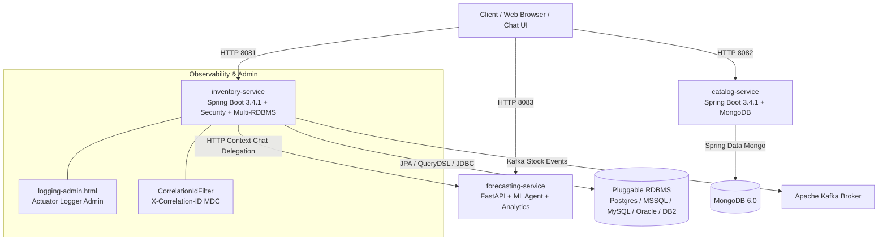

<!--
  Copyright (c) 2026 Vivek Umrao.

  Licensed under the Apache License, Version 2.0 (the "License");
  you may not use this file except in compliance with the License.
  You may obtain a copy of the License at

      http://www.apache.org/licenses/LICENSE-2.0

  Unless required by applicable law or agreed to in writing, software
  distributed under the License is distributed on an "AS IS" BASIS,
  WITHOUT WARRANTIES OR CONDITIONS OF ANY KIND, either express or implied.
  See the License for the specific language governing permissions and
  limitations under the License.
-->

# Smart Inventory Management System

[](https://openjdk.org/)
[](https://spring.io/projects/spring-boot)
[](https://fastapi.tiangolo.com/)
[](https://gradle.org/)
[](https://docs.docker.com/compose/)
[](infra/helm/smart-inventory)
[](LICENSE)

A production-grade, polyglot microservices platform engineered for real-time stock management, dynamic product catalogs, statistical demand forecasting, and **agentic AI-driven inventory intelligence**. 

Built with **Java 17/21**, **Spring Boot 3.4.1**, **FastAPI (Python 3.11)**, **MongoDB**, **HikariCP**, **Hibernate JPA**, **Spring Security (RBAC)**, **Apache Kafka**, **Docker**, and **Helm**.

Supports pluggable enterprise relational databases through runtime dialect abstraction: **PostgreSQL, Microsoft SQL Server, MySQL, Oracle, and IBM DB2**.

---

## 🌟 Key Capabilities & Feature Highlights

1. **📦 Transactional Inventory Service (`inventory-service`)**:
   - Thread-safe stock tracking, batch adjustments, and immutable transaction audit logs ([`StockTransaction`](file:///home/user/work/Agentic-inventory/inventory-service/src/main/java/com/smartinventory/inventory/model/StockTransaction.java)).
   - Multi-database dialect persistence framework ([`QueryDialect`](file:///home/user/work/Agentic-inventory/inventory-service/src/main/java/com/smartinventory/inventory/db/dialect/QueryDialect.java)) supporting PostgreSQL, MySQL, Oracle, SQL Server, and DB2 with zero proprietary lock-in.
   - Programmatic transaction boundaries and custom isolation levels ([`DatabaseTransactionManager`](file:///home/user/work/Agentic-inventory/inventory-service/src/main/java/com/smartinventory/inventory/db/DatabaseTransactionManager.java)).
   - Event-driven stock update publishing to **Apache Kafka** ([`KafkaProducerService`](file:///home/user/work/Agentic-inventory/inventory-service/src/main/java/com/smartinventory/inventory/kafka/KafkaProducerService.java)).

2. **🍃 Dynamic Product Catalog Service (`catalog-service`)**:
   - Flexible document-based product management powered by **MongoDB**.
   - Dynamic key-value technical specifications, categories, brands, tags, and pricing ([`Product`](file:///home/user/work/Agentic-inventory/catalog-service/src/main/java/com/smartinventory/catalog/model/Product.java)).
   - Automated bootstrap seeders ([`CatalogDataInitializer`](file:///home/user/work/Agentic-inventory/catalog-service/src/main/java/com/smartinventory/catalog/config/CatalogDataInitializer.java)).

3. **🤖 Agentic AI Assistant & Forecasting Service (`forecasting-service`)**:
   - **Trained Machine Learning Intent Classifier**: Scikit-Learn TF-IDF vectorizer + Calibrated Logistic Regression trained on 1,700+ balanced queries covering 15 operational intents ([`train_classifier.py`](file:///home/user/work/Agentic-inventory/forecasting-service/train_classifier.py)).
   - **Named Entity Recognition (NER) & Slot Extraction**: Dynamic extraction of SKUs, warehouse locations, product categories, and top-N numeric filters.
   - **Human-like Synthesis Engine**: Generates formatted markdown tables, operational metrics, stock deficit audits, capital valuations, and prioritized supply chain recommendations.
   - **Dual-Mode AI Architecture**: Seamless routing to external LLMs (Google Gemini / OpenAI) when API keys are configured, with automatic fallback to offline local ML and statistical synthesis.
   - **Inventory Science & Demand Forecasting**: Multi-period exponential smoothing, linear trend regression, anomaly detection, statistical safety stock ($Z=1.65$, 95% service level), and dynamic Reorder Points (ROP).
   - **Instruction-Tuning Dataset**: 350+ conversational dialogues in OpenAI Chat / Alpaca SFT format ([`instruction_tuning_dataset.jsonl`](file:///home/user/work/Agentic-inventory/forecasting-service/data/instruction_tuning_dataset.jsonl)).

4. **💻 Interactive Web Chat UI & Multi-Format Export Engine**:
   - Web-based AI workspace served directly at **[`http://localhost:8081/`](http://localhost:8081/)** or **[`http://localhost:8081/chat.html`](http://localhost:8081/chat.html)**.
   - Real-time conversational streaming and `marked.js` markdown table rendering.
   - **Multi-Format Export Suite**:
     - 📊 **Excel Spreadsheet (`.xlsx`)** via SheetJS (xlsx.js).
     - 📄 **Word Document (`.docx`)** via docx.js (true Microsoft OpenXML standard).
     - 📑 **PDF Document (`.pdf`)** via html2pdf.js.
     - ⚡ **Smart Export**: Auto-detects tabular matrices vs narrative reports and exports to optimal format.
   - Quick prompt suggestion chips (Tabular SKU Matrix, Low Stock Audit, Valuation, Executive Brief, etc.).

5. **🔐 Enterprise Security & Role-Based Access Control (RBAC)**:
   - Spring Security HTTP Basic authentication with BCrypt password hashing.
   - Database-backed domain entities: [`UserEntity`](file:///home/user/work/Agentic-inventory/inventory-service/src/main/java/com/smartinventory/inventory/model/UserEntity.java), [`RoleEntity`](file:///home/user/work/Agentic-inventory/inventory-service/src/main/java/com/smartinventory/inventory/model/RoleEntity.java), and [`PermissionEntity`](file:///home/user/work/Agentic-inventory/inventory-service/src/main/java/com/smartinventory/inventory/model/PermissionEntity.java).
   - Pre-seeded system accounts: `admin` (`ROLE_ADMIN`), `manager` (`ROLE_MANAGER`), `operator` (`ROLE_ENTRY_OPERATOR`), `viewer` (`ROLE_USER`).
   - Administrative User Management API ([`UserManagementController`](file:///home/user/work/Agentic-inventory/inventory-service/src/main/java/com/smartinventory/inventory/controller/UserManagementController.java)).

6. **🔍 Distributed Observability & Dynamic Logging Administration**:
   - Distributed **Correlation ID Tracing** (`X-Correlation-ID`) across Java microservices via [`CorrelationIdFilter`](file:///home/user/work/Agentic-inventory/inventory-service/src/main/java/com/smartinventory/inventory/config/CorrelationIdFilter.java) and SLF4J MDC.
   - **Web Logging Admin Console** at **[`http://localhost:8081/logging-admin.html`](http://localhost:8081/logging-admin.html)** allowing real-time inspection and runtime log level modifications without restarting containers.

7. **☸️ Cloud-Native Deployment & Orchestration**:
   - **Unified Management Utility**: [`scripts/setup.sh`](file:///home/user/work/Agentic-inventory/scripts/setup.sh) for one-command environment lifecycle management (`fresh`, `up`, `destroy`, `clean`, `reload`, `seed`).
   - **Docker Compose**: [`infra/docker-compose.dev.yml`](file:///home/user/work/Agentic-inventory/infra/docker-compose.dev.yml) orchestrating all polyglot microservices, brokers, and multi-DB profiles.
   - **Helm Chart**: Production-ready Kubernetes chart at [`infra/helm/smart-inventory`](file:///home/user/work/Agentic-inventory/infra/helm/smart-inventory) with ingress, configurable endpoints, resources, and health probes.

---

## 🏛️ System Architecture



---

## 🚀 Microservices & Port Map

| Service / Component | Technology Stack | Port | Persistence / Messaging | Primary Responsibilities |
| :--- | :--- | :--- | :--- | :--- |
| **`inventory-service`** | Java 17/21, Spring Boot 3.4.1, Spring Security | `8081` | PostgreSQL (or MSSQL, MySQL, Oracle, DB2) | Inventory stock items, transactions, multi-dialect SQL engine, Kafka producer, RBAC user management, Chat UI host, Logging Admin. |
| **`catalog-service`** | Java 17/21, Spring Boot 3.4.1 | `8082` | MongoDB | Product catalog, dynamic attributes, categories, pricing, tag filtering. |
| **`forecasting-service`** | Python 3.11, FastAPI, Scikit-Learn | `8083` | In-Memory / Joblib | ML Intent Classifier, NER entity extractor, human synthesis engine, demand forecasting, statistical safety stock. |
| **`integration-tests`** | JUnit 5, Spring Boot Test, Testcontainers | N/A | Embedded H2 & Mongo | Cross-service end-to-end integration tests and AI agent context hydration tests. |

---

## ⚡ Quick Start Guide

The project provides an all-in-one management script [`scripts/setup.sh`](file:///home/user/work/Agentic-inventory/scripts/setup.sh) that configures Docker containers, networking, and seed data automatically.

### 1. Start Fresh Environment (One Command)
Tears down existing containers/volumes, sets up the database engine, compiles services, starts all containers, and seeds sample data:
```bash
# Default (PostgreSQL)
./scripts/setup.sh fresh

# Or choose any enterprise relational database:
./scripts/setup.sh fresh mysql
./scripts/setup.sh fresh mssql
./scripts/setup.sh fresh oracle
./scripts/setup.sh fresh db2
```

### 2. Start Existing Environment
```bash
./scripts/setup.sh up postgres
```

### 3. Hot-Reload Microservices After Code Changes
Rebuilds and reloads microservice containers without restarting databases or Kafka brokers:
```bash
./scripts/setup.sh reload forecasting-service
./scripts/setup.sh reload inventory-service
./scripts/setup.sh reload catalog-service
./scripts/setup.sh reload all
```

### 4. Seed or Re-seed Sample Data
```bash
./scripts/setup.sh seed
```

### 5. Stop or Destroy Environment
```bash
# Stop containers (preserves database volumes)
./scripts/setup.sh destroy

# Clean everything (wipes containers, networks, volumes, local images, and .env)
./scripts/setup.sh clean
```

---

## 🌐 Web Interfaces & Dashboards

- **🤖 AI Agent Web Chat UI**: [`http://localhost:8081/`](http://localhost:8081/) or [`http://localhost:8081/chat.html`](http://localhost:8081/chat.html)
- **📋 Dynamic Logging Admin Console**: [`http://localhost:8081/logging-admin.html`](http://localhost:8081/logging-admin.html) *(Requires `admin` credentials)*
- **📚 Inventory Swagger UI**: [`http://localhost:8081/swagger-ui.html`](http://localhost:8081/swagger-ui.html) *(Basic Auth: `admin` / `password`)*
- **📚 Catalog Swagger UI**: [`http://localhost:8082/swagger-ui.html`](http://localhost:8082/swagger-ui.html)
- **⚡ Forecasting OpenAPI / Docs**: [`http://localhost:8083/docs`](http://localhost:8083/docs)

---

## 📖 Complete Documentation Suite

Comprehensive engineering specifications, designs, and guides are located in the [`docs/`](docs/README.md) directory:

- 🏗️ **[System Architecture & Engineering Guide](docs/ARCHITECTURE.md)**: Deep dive into microservice contexts, clean architecture, SOLID compliance, sequence diagrams, and resilience.
- 🤖 **[AI Agent Architecture & Pipeline Specs](docs/AI_AGENT_ARCHITECTURE.md)**: Machine learning intent classifier, NER slot filling, synthesis engine, and inventory science formulas.
- 🔬 **[AI Agent Investigation & Training Report](docs/AI_AGENT_INVESTIGATION_AND_TRAINING.md)**: Detailed report on root cause fixes, training data schemas, and ML training pipelines.
- 🗄️ **[Database Schemas & Kafka Messaging Guide](docs/DATABASE_AND_MESSAGING.md)**: Relational tables (Postgres, MSSQL, MySQL, Oracle, DB2), MongoDB document schemas, and Kafka event specifications.
- ⛵ **[Helm Chart Deployment Guide](docs/HELM_DEPLOYMENT.md)**: Distributed Kubernetes deployment, parameterizable Helm values, ingress routing, and multi-cloud setup.
- 🧪 **[Testing Strategy, JaCoCo & DevOps Guide](docs/TESTING_AND_DEVOPS.md)**: Multi-layered testing strategy, Testcontainers integration, JaCoCo reports, and CI/CD best practices.
- 📘 **[Developer Guide & System Manual](docs/README.md)**: Complete developer handbook, security configurations, and REST API reference.

---

## 📜 License & Copyright

```text
Copyright (c) 2026 Vivek Umrao.

Licensed under the Apache License, Version 2.0 (the "License");
you may not use this file except in compliance with the License.
You may obtain a copy of the License at

    http://www.apache.org/licenses/LICENSE-2.0

Unless required by applicable law or agreed to in writing, software
distributed under the License is distributed on an "AS IS" BASIS,
WITHOUT WARRANTIES OR CONDITIONS OF ANY KIND, either express or implied.
See the License for the specific language governing permissions and
limitations under the License.
```
