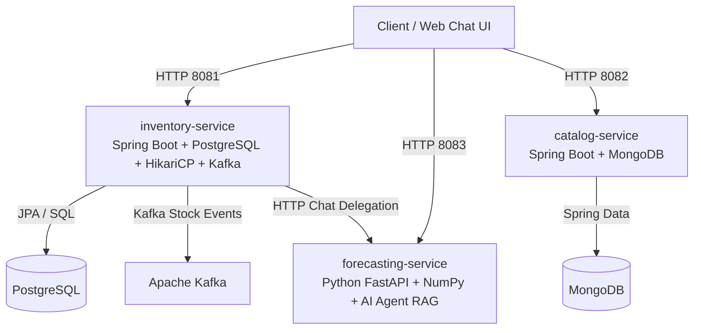

# Smart Inventory Management System

[](https://openjdk.org/)
[](https://spring.io/projects/spring-boot)
[](https://fastapi.tiangolo.com/)
[](https://gradle.org/)
[](https://docs.docker.com/compose/)
[](LICENSE)

A production-grade, polyglot microservices architecture designed for modern inventory management, real-time stock tracking, dynamic product catalogs, demand forecasting, and **agentic AI-driven inventory insights**. Built with **Spring Boot 3.4.1**, **FastAPI**, **MongoDB**, **HikariCP**, **Hibernate JPA**, **Spring Security**, **Apache Kafka**, and **Docker**.

Supports multiple relational databases through dynamic setup configurations including **PostgreSQL, Microsoft SQL Server, MySQL, Oracle, and IBM DB2**.

---

## 🏗️ System Architecture & SOLID Principles



### Key Design & Architectural Principles
- **SOLID Principles**: Single Responsibility (layered Controller-Service-Repository), Open/Closed (extensible DTO mappings), Liskov Substitution, Interface Segregation, and Dependency Inversion (Spring Constructor Injection).
- **Twelve-Factor App Configuration**: Fully externalized application properties and environment variable bindings.
- **Resilient Fallback Design**: Circuit-breaker style fallback mechanisms in microservice inter-service communication.
- **High Code Quality & Test Coverage**: JaCoCo integration testing suite across all Java and Python modules.

---

## 💬 Interactive Web Chat UI

You can open the web-based chat interface in any browser:
👉 **[`http://localhost:8081/`](http://localhost:8081/)** or **[`http://localhost:8081/chat.html`](http://localhost:8081/chat.html)**

Features include:
- **Real-time conversation stream** with the AI Agent.
- **Markdown Table Matrix Rendering** (renders clean HTML tables for SKU list requests).
- **Quick Query Suggestion Chips** (Tabular SKU Matrix, SKU Count, Stock Type Breakdown, Low Stock Audit, Total Valuation, Executive Brief).
- **Formatted Markdown outputs**, risk indicators (`CRITICAL`, `HIGH`, `MEDIUM`, `LOW`), and actionable recommendations list.

---

## 🚀 Microservices & Modules Overview

| Service / Module | Technology | Port | Database / Broker | Primary Responsibility |
| :--- | :--- | :--- | :--- | :--- |
| **`inventory-service`** | Java 17, Spring Boot 3.4.1, HikariCP | `8081` | Pluggable RDBMS (Postgres, MSSQL, etc.) | Manages inventory items, stock adjustments, audit transactions, Kafka event publishing, Spring Security, and **Web Chat UI & AI Chat API**. |
| **`catalog-service`** | Java 17, Spring Boot 3.4.1 | `8082` | MongoDB | Manages flexible product catalog metadata, categories, pricing, and dynamic attributes. |
| **`forecasting-service`** | Python 3.11, FastAPI, NumPy, Pandas | `8083` | In-memory / Numpy | Provides predictive SKU demand forecasting and an **Agentic AI Assistant** with Human Synthesis Engine for natural language operational intelligence. |
| **`integration-tests`** | JUnit 5, Spring Boot Test, Testcontainers | N/A | Embedded H2 / Mongo | Dedicated integration and end-to-end testing suite validating cross-service workflows. |

---

## 📋 Prerequisites

Before running the project, ensure you have installed:
- **Java Development Kit (JDK) 17+**
- **Python 3.11+** (for forecasting & AI service)
- **Docker & Docker Compose** (for containerized execution)
- **Gradle 8.x** (included via `./gradlew` wrapper)

---

## ⚡ Quick Start Guide & Unified Environment Management

The project provides a robust unified setup utility (`./scripts/setup.sh`) to manage the entire environment lifecycle with single commands.

Available databases: `postgres` (default), `mssql`, `mysql`, `oracle`, `db2`.
Custom variables (such as `DB_PORT`, `DB_USER`, `DB_PASSWORD`) can also be passed via environment variables.

### 1. Start Fresh Environment (Single Command)
Destroys any existing containers and volumes, configures the database, builds and starts all microservices, and automatically seeds sample data:
```bash
# Default (PostgreSQL)
./scripts/setup.sh fresh

# Or choose a specific database engine
./scripts/setup.sh fresh postgres
./scripts/setup.sh fresh mysql
./scripts/setup.sh fresh mssql
```

### 2. Start Existing Environment
Starts containers without resetting volumes or re-seeding data:
```bash
./scripts/setup.sh up postgres
```

### 3. Destroy Environment (Keep Volumes)
Stops and removes containers while preserving database volumes:
```bash
./scripts/setup.sh destroy
```

### 4. Clean Project Completely
Stops and removes all containers, volumes, networks, local images, and `.env` configuration:
```bash
./scripts/setup.sh clean
```

### 5. Reload Services with New Code
Rebuilds and reloads microservices without bringing down databases or brokers:
```bash
# Reload Python AI Forecasting Service
./scripts/setup.sh reload forecasting-service

# Reload Spring Boot Inventory Service
./scripts/setup.sh reload inventory-service

# Reload Spring Boot Catalog Service
./scripts/setup.sh reload catalog-service

# Reload all microservices at once
./scripts/setup.sh reload all
```

### 6. Manually Seed Sample Data
```bash
./scripts/setup.sh seed
```

---

## 📚 API Endpoints & Swagger Documentation

### 1. Inventory Service (`http://localhost:8081`)
- **Web Chat UI**: [`http://localhost:8081/`](http://localhost:8081/) or [`http://localhost:8081/chat.html`](http://localhost:8081/chat.html)
- **Swagger UI**: [`http://localhost:8081/swagger-ui.html`](http://localhost:8081/swagger-ui.html) *(Authentication: Username `admin`, Password `password`)*
- **Key Endpoints**:
  - `POST /api/ai/agent/chat` - **AI Agent Interactive Chat Endpoint**
  - `GET /api/inventory` - List inventory (supports `?lowStock=true`)
  - `GET /api/inventory/{sku}` - Get inventory item by SKU
  - `POST /api/inventory` - Create inventory item *(Authenticated)*
  - `POST /api/inventory/{sku}/adjust` - Adjust stock quantities *(Authenticated)*
  - `GET /api/inventory/{sku}/transactions` - Get stock audit transaction log

### 2. Catalog Service (`http://localhost:8082`)
- **Swagger UI**: [`http://localhost:8082/swagger-ui.html`](http://localhost:8082/swagger-ui.html)
- **Key Endpoints**:
  - `GET /api/catalog` - List all products (supports `?category=...`)
  - `GET /api/catalog/{id}` - Get product by ID
  - `GET /api/catalog/sku/{sku}` - Get product by SKU
  - `POST /api/catalog` - Create product
  - `PUT /api/catalog/{id}` - Update product
  - `DELETE /api/catalog/{id}` - Delete product

### 3. AI & Forecasting Service (`http://localhost:8083`)
- **Interactive Docs**: [`http://localhost:8083/docs`](http://localhost:8083/docs)
- **Key Endpoints**:
  - `POST /api/ai/agent/chat` - **AI Agent Assistant Endpoint**
  - `POST /forecast` - Calculate time-series demand projections using exponential smoothing.

---

## 📜 License

Distributed under the MIT License. See [LICENSE](LICENSE) for more information.
