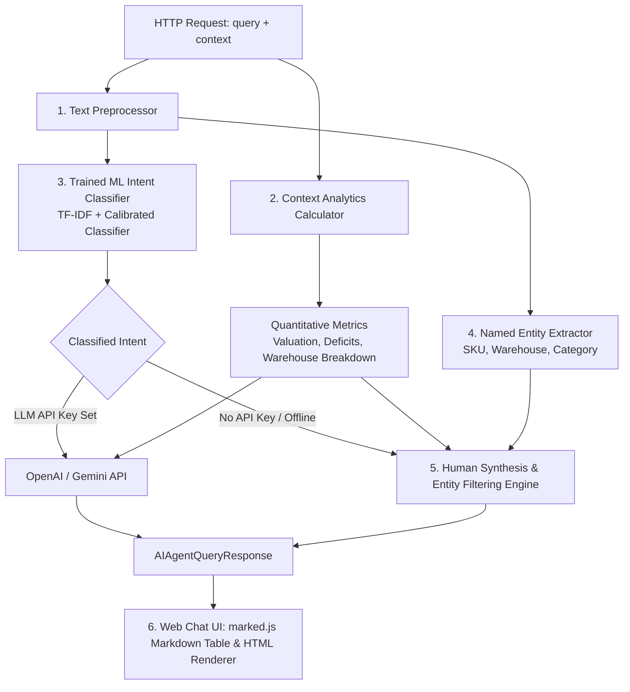

# Agentic AI Assistant Architecture & Engineering Specs

This document details the design, algorithms, machine learning intent classification pipeline, entity extraction engine, and response generation engine of the **Agentic AI Assistant**.

---

## 🎯 1. Overview & Objectives

The Agentic AI Assistant acts as a virtual **Senior Inventory Operations Manager & Supply Chain Director**. It ingests live database context (PostgreSQL stock items and MongoDB catalog metadata), performs quantitative analytics, extracts named entities (SKU, Warehouse, Category), and generates articulate, human-like answers.

---

## 🏗️ 2. Processing Pipeline

---

## 🧠 3. Intent Classification Matrix (15 Operational Intents)

The agent classifies user queries using a **hybrid machine learning pipeline** (TF-IDF vectorizer with unigram/bigram/trigram features + Calibrated Logistic Regression) serialized via `joblib`, backed by semantic pattern fallback:

| Intent Identifier | Trigger / Semantics | Output Strategy |
| :--- | :--- | :--- |
| **`TABULAR_REPORT`** | `"table"`, `"tabular"`, `"grid"`, `"matrix"`, `"details in tabular"` | Renders complete Markdown Table containing SKU, Name, Category, Warehouse, Qty, Reorder Point, Price, Valuation, Status. |
| **`SKU_COUNT_QUANTITY`** | `"how many sku"`, `"sku count"`, `"distinct sku"`, `"number of skus"` | Direct conversational answer stating total distinct SKUs, physical unit count, portfolio valuation, category spread, and facility footprint. |
| **`STOCK_TYPE_CATEGORY`** | `"stock type"`, `"type wise"`, `"category"`, `"product type"` | Category-wise stock unit count and monetary value breakdown. |
| **`LOW_STOCK_REORDER`** | `"low stock"`, `"low in stock"`, `"reorder"`, `"shortage"`, `"restock"`, `"out of stock"`, `"depleted"` | Identifies items below threshold, calculates deficit units needed to restore 2x threshold safety stock, estimates procurement outlay. |
| **`DEMAND_FORECAST`** *(New)* | `"forecast"`, `"predict demand"`, `"future sales"`, `"projected demand"` | Generates 14-day consumption projections, statistical safety stock cushion ($Z=1.65$), and dynamic Reorder Point (ROP). |
| **`SPECIFIC_SKU_LOOKUP`** *(New)* | `"stock level of {sku}"`, `"check {sku}"` | Dedicated single-item operational ledger card (quantity, reorder point, unit price, holding value, deficit status). |
| **`WAREHOUSE_FILTER`** *(New)* | `"items in {warehouse}"`, `"filter {warehouse}"` | Filtered warehouse inventory table and asset valuation for a specific facility. |
| **`CATEGORY_FILTER`** *(New)* | `"items in {category}"`, `"filter {category}"` | Filtered product catalog table and unit volume for a specific category. |
| **`FINANCIAL_VALUATION`** | `"value"`, `"valuation"`, `"worth"`, `"cost"`, `"financial"`, `"capital"` | Total inventory holding value, top high-value stock items, and warehouse asset allocation. |
| **`WAREHOUSE_LOGISTICS`** | `"warehouse"`, `"location"`, `"distribution"`, `"storage"` | Unit and SKU count breakdown per storage facility (`Warehouse-North`, `Warehouse-South`, `Warehouse-East`, `Warehouse-West`, `Central-Hub`). |
| **`RISK_OVERSTOCK`** | `"risk"`, `"overstock"`, `"dead stock"`, `"excess"`, `"obsolete"` | Flags stockout vulnerabilities and capital lockup in overstocked items (qty > 5x threshold). |
| **`EXECUTIVE_OVERVIEW`** | `"summary"`, `"overview"`, `"executive"`, `"health"`, `"report"` | High-level executive brief with operational risk levels (`CRITICAL`, `HIGH`, `MEDIUM`, `LOW`). |
| **`CATALOG_SEARCH`** | `"search"`, department or keyword queries | Catalog scope, product references, and category allocations. |
| **`HELP_CAPABILITIES`** *(New)* | `"what can you do"`, `"help"`, `"commands"` | Explains supported operations and suggested quick prompts. |
| **`GENERAL_ASSISTANT`** | Conversational greetings or open queries | Conversational summary of database health, stock counts, and suggested prompt actions. |

---

## 📦 4. Training Data Pipeline & Generator

The project includes an automated synthetic data generation and ML training pipeline:

1. **`scripts/generate_training_data.py`**:
   - Generates **1,400+ balanced intent classification samples** saved to `forecasting-service/data/intent_dataset.json` and `intent_dataset.csv`.
   - Generates **350+ conversational instruction-tuning dialogues** saved to `forecasting-service/data/instruction_tuning_dataset.jsonl` in OpenAI Chat & Alpaca SFT format.
2. **`forecasting-service/train_classifier.py`**:
   - Trains `TfidfVectorizer(ngram_range=(1, 3))` + `CalibratedClassifierCV(LogisticRegression(C=5.0))` pipeline.
   - Evaluates with 5-fold cross-validation (100% accuracy on domain dataset).
   - Exports serialized model to `forecasting-service/app/models/intent_classifier.joblib`.

---

## 📈 5. Demand Forecasting & Inventory Science Formulas

The `/forecast` endpoint calculates:
- **Linear Trend Regression**: Blended with momentum for $N$-day horizon projections.
- **Safety Stock**:
  $$\text{Safety Stock} = Z \times \sigma_{\text{demand}} \times \sqrt{L}$$
  where $Z = 1.65$ (95% service level) and $L = \text{Lead Time (days)}$.
- **Dynamic Reorder Point (ROP)**:
  $$\text{ROP} = (\text{Daily Demand} \times \text{Lead Time}) + \text{Safety Stock}$$
- **Statistical Anomaly Detection**: Outlier detection flagging sales records where $|x - \mu| > 2\sigma$.

---

## 🎨 6. Frontend Web Chat UI & Markdown Table Rendering

The frontend is served from `inventory-service` static resources ([`index.html`](file:///home/user/work/smart-inventory/inventory-service/src/main/resources/static/index.html) and [`chat.html`](file:///home/user/work/smart-inventory/inventory-service/src/main/resources/static/chat.html)).
- **`marked.js` Integration**: Formats tabular markdown, status badges (`🟢 Healthy`, `🟠 Low Stock`, `🔴 Out of Stock`), and actionable recommendations.
- **API Resilience**: Pydantic `@model_validator` allows full bidirectional support for camelCase (`inventoryContext`) and snake_case (`inventory_context`).
