# Deep Investigation Report: AI Agent Architecture, Bottlenecks & Improvement Blueprint

**Project**: Smart Inventory Management System  
**Date**: October 2026  
**Status**: Investigation Complete — Root Causes Identified & Enhancement Strategy Formulated  

---

## Executive Summary

A deep architectural and code-level investigation was conducted into the Smart Inventory AI Agent, the Python forecasting service (`forecasting-service`), the Java microservices (`inventory-service`, `catalog-service`), and the end-to-end communication pipeline.

The investigation revealed that **the AI Agent currently fails in multiple foundational areas**:
1. **Critical Protocol Bug (422 Unprocessable Entity)**: The AI Agent in `forecasting-service` is **never actually reached** by `inventory-service` in live runs due to a JSON field casing mismatch (`inventoryContext` vs `inventory_context`), causing silent fallback to a rudimentary Java mock method.
2. **Brittle Rule-Based Classification**: The agent relies on simplistic substring checks without machine learning, statistical NLP, or semantic embeddings. Even documented test cases fail (`"Which items are low in stock?"` fails because `"low in stock"` was omitted from regex checks).
3. **Complete Absence of Training Data & ML Pipeline**: There is no training data, no intent classification model, and no instruction-tuning dataset in the repository, despite `scikit-learn` and `joblib` being declared in `requirements.txt`.
4. **Lack of Named Entity Recognition (NER) / Slot Filling**: The agent cannot filter by specific SKU, warehouse, category, or numeric criteria (e.g., asking about `LAPTOP-PRO-15` returns an aggregate summary of all 30 SKUs).
5. **Primitive Demand Forecasting**: Demand forecasting in `/forecast` uses a basic 3-point rolling average with an arbitrary trend slope, ignoring real machine learning regression, seasonal patterns, anomaly detection, and dynamic safety stock formulas.
6. **Broken Test Suites in CI/CD**: Both the Python test suite and Java Gradle test suites have failing tests due to unhandled intent patterns, MongoDB connection timeouts in actuator tests, and H2 `data.sql` execution order.

---

## 1. Deep Dive: Discovered Bugs & Root Causes

### 1.1 Silent Integration Failure: The CamelCase vs SnakeCase Mismatch
* **Location**: `forecasting-service/app/main.py` (`AIAgentQueryRequest`) & `inventory-service/src/main/java/.../AiAgentService.java`.
* **Issue**:
  - `inventory-service` sends:
    ```json
    {
      "query": "Which items are low in stock?",
      "inventoryContext": [...],
      "catalogContext": [...]
    }
    ```
  - `forecasting-service` defines:
    ```python
    class AIAgentQueryRequest(BaseModel):
        query: str
        inventory_context: List[Dict[str, Any]]
        catalog_context: Optional[List[Dict[str, Any]]] = None
    ```
  - Pydantic v2 rejects the request with **HTTP 422 Unprocessable Entity (`Field required: inventory_context`)**.
  - `AiAgentService.java` catches this exception and falls back to `generateFallbackResponse()`.
  - **Impact**: The Python AI Agent has been completely bypassed in live operations.

### 1.2 Failing Python Test: Keyword Matching Omission
* **Location**: `forecasting-service/app/agent.py` (`_classify_intent`).
* **Test Failure**: `test_ai_inventory_assistant_low_stock` in `app/test_main.py`:
  ```python
  payload = {"query": "Which items are low in stock?", ...}
  # Expected: risk_level in ["HIGH", "CRITICAL"]
  # Actual: "LOW" (AssertionError)
  ```
* **Root Cause**: `_classify_intent` searches for `"low stock"`, but not `"low in stock"`. The query falls through to `GENERAL_ASSISTANT`, returning `risk_level: "LOW"`. Even though `"low in stock"` is listed in `docs/AI_AGENT_ARCHITECTURE.md`, it was never added to the code.

### 1.3 Failing Gradle Tests in Catalog & Inventory Services
1. **`CatalogActuatorLoggerTest` (`catalog-service`)**:
   - `MongoTimeoutException`: `@SpringBootTest` boots the application context requiring MongoDB at `localhost:27017`. Without test mocking or an embedded DB, tests fail if MongoDB is offline.
2. **`InventoryActuatorLoggerTest` (`inventory-service`)**:
   - `JdbcSQLSyntaxErrorException: Table \"ROLES\" not found`: Spring Boot executes `data.sql` before Hibernate creates tables with `ddl-auto: create-drop` because `spring.jpa.defer-datasource-initialization: true` is missing in `src/test/resources/application.yml`.

---

## 2. AI Agent Bottlenecks & Limitations

```mermaid
flowchart TD
    subgraph Current_State["Current State (Brittle & Broken)"]
        Q1["User Query"] --> C1{"Sub-string Matching<br/>(10 if-statements)"}
        C1 -->|Misses synonyms, typos| G1["GENERAL_ASSISTANT (Fallback)"]
        C1 -->|Matches| T1["Static Template Synthesis"]
        T1 --> R1["Generic Output (No Entity Filtering)"]
    end

    subgraph Proposed_State["Target Architecture (Trained ML + Slot Filling)"]
        Q2["User Query"] --> PRE["Text Preprocessor"]
        PRE --> ML["Trained ML Intent Classifier<br/>(TF-IDF + Calibrated Logistic Regression)"]
        PRE --> NER["Entity & Slot Extractor<br/>(SKUs, Warehouses, Categories, Thresholds)"]
        ML --> FUSION["Decision Fusion & Confidence Scoring"]
        NER --> FUSION
        FUSION --> CONTEXT["Dynamic Context Filtering & Analytics"]
        CONTEXT --> SYNTH["Human Synthesis & Forecasting Engine"]
        SYNTH --> R2["Accurate, Filtered, Analytical Response"]
    end
```



### 2.1 Limitations Breakdown
| Dimension | Current State | Target State |
| :--- | :--- | :--- |
| **Intent Classification** | 10 hardcoded substring checks | Trained ML classifier (`scikit-learn` TF-IDF + Logistic Regression / Calibrated Classifier) with 15+ intents + high-confidence fallback |
| **Dataset** | None (0 examples) | 1,500+ annotated intent & entity examples + 500+ conversational instruction-tuning dialogues |
| **Entity Extraction** | None | Regex & fuzzy matcher extracting `SKU`, `WAREHOUSE`, `CATEGORY`, `COMPARISON_OP`, `QUANTITY` |
| **Filtered Queries** | Not supported (dumps all SKUs) | Fully dynamic filtering (e.g. "show laptops in Warehouse-North" returns only relevant items) |
| **Forecasting Integration** | Disconnected from conversational agent | Agent handles `DEMAND_FORECAST` intent and calls ML forecasting models with lead-time safety stock |
| **Demand Forecasting Model** | Simple 3-point rolling average | Ridge / Linear ML regression with lag features, trend, confidence intervals, and anomaly detection |
| **API Compatibility** | Rejects camelCase (422 error) | Pydantic model with aliases supporting both camelCase and snake_case |

---

## 3. Training Data Architecture

To thoroughly train and evaluate the AI agent, we will introduce:

### 3.1 Intent Classification Dataset (`intent_dataset.json` / `.csv`)
* **Size**: 1,500+ unique, balanced user queries across 15 distinct operational intents:
  1. `TABULAR_REPORT`
  2. `SKU_COUNT_QUANTITY`
  3. `STOCK_TYPE_CATEGORY`
  4. `LOW_STOCK_REORDER`
  5. `FINANCIAL_VALUATION`
  6. `WAREHOUSE_LOGISTICS`
  7. `RISK_OVERSTOCK`
  8. `EXECUTIVE_OVERVIEW`
  9. `CATALOG_SEARCH`
  10. `DEMAND_FORECAST`
  11. `SPECIFIC_SKU_LOOKUP`
  12. `WAREHOUSE_FILTER`
  13. `CATEGORY_FILTER`
  14. `HELP_CAPABILITIES`
  15. `GENERAL_ASSISTANT`
* **Characteristics**: Covers formal enterprise inquiries, casual warehouse operator phrasing, abbreviations, typos, and edge-case permutations.

### 3.2 Conversational Instruction-Tuning Dataset (`instruction_tuning_dataset.jsonl`)
* **Format**: OpenAI Chat format & Alpaca format with messages:
  `[{"role": "system", ...}, {"role": "user", ...}, {"role": "assistant", ...}]`
* **Use Case**: Ready for fine-tuning open-source LLMs (Llama-3, Mistral, Gemma) or OpenAI models.

### 3.3 Synthetic Data Generator Script (`generate_training_data.py`)
* Procedural generator that combines catalog master data, warehouses, categories, linguistic frames, typo simulations, and exports to JSON, CSV, and JSONL formats.

---

## 4. Machine Learning & Forecasting Improvements

### 4.1 ML Intent Classifier Pipeline (`train_classifier.py`)
* **Vectorizer**: `TfidfVectorizer(ngram_range=(1, 3), sublinear_tf=True, min_df=2)`
* **Estimator**: `CalibratedClassifierCV(LogisticRegression(C=1.0, max_iter=1000))`
* **Artifact**: Serialized to `forecasting-service/app/models/intent_classifier.joblib`
* **Evaluation**: Cross-validation accuracy, precision, recall, F1-score, and confusion matrix report.

### 4.2 Enhanced Demand Forecasting & Anomaly Detection
* **Model**: Auto-regressive feature extraction with `scikit-learn` Ridge regression.
* **Safety Stock Calculation**: $\text{Safety Stock} = Z \times \sigma_{\text{demand}} \times \sqrt{L}$
* **Anomaly Detection**: Z-score and rolling IQR flagging abnormal demand spikes.

---

## 5. End-to-End Implementation Roadmap

1. **Fix API Compatibility**: Add alias support (`validation_alias` / `@model_validator`) in `AIAgentQueryRequest`.
2. **Build Synthetic Training Data Generator & Datasets**: Create `scripts/generate_training_data.py` and generate datasets.
3. **Build Training & Evaluation Pipeline**: Create `forecasting-service/train_classifier.py` and save model.
4. **Upgrade AI Agent Core (`app/agent.py`)**: Integrate ML classifier, slot filling, new intents, dynamic filtering.
5. **Upgrade Forecasting Service (`app/main.py`)**: Implement ML demand forecasting with safety stock and anomaly detection.
6. **Fix Broken Unit & Actuator Tests**: Fix `test_ai_inventory_assistant_low_stock`, `CatalogActuatorLoggerTest`, and `InventoryActuatorLoggerTest`.
7. **Verify & Validate**: Run full test suites in Docker and Gradle to verify 100% pass rate.
