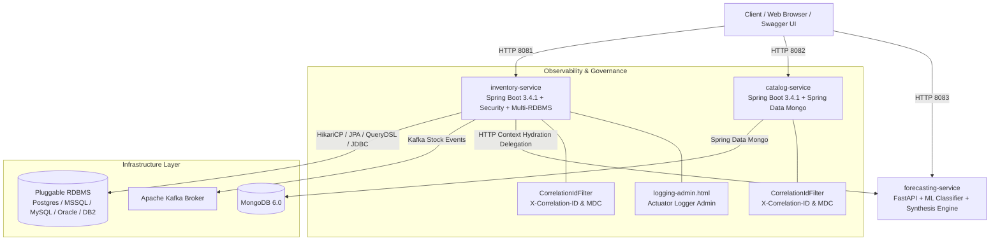
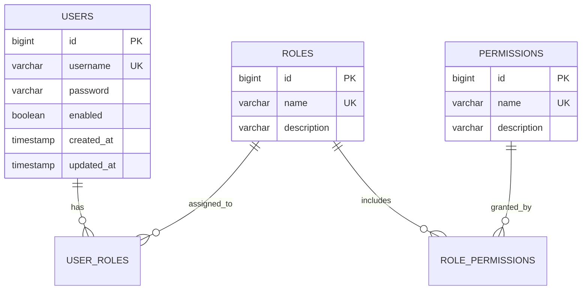
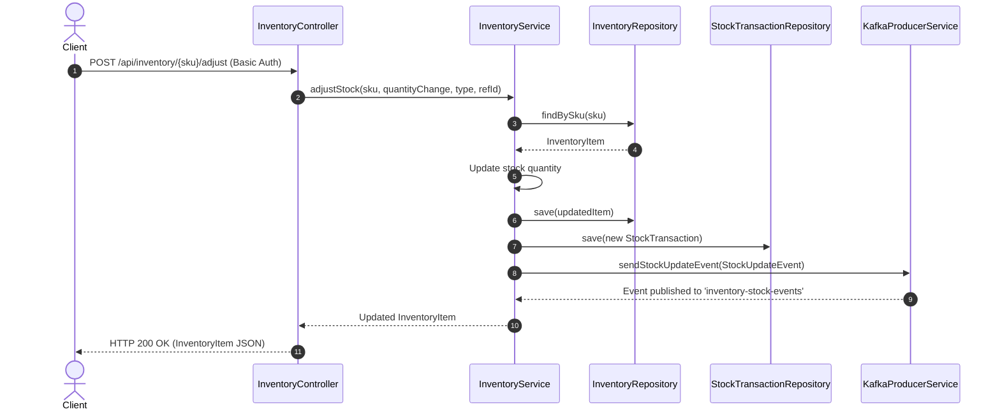
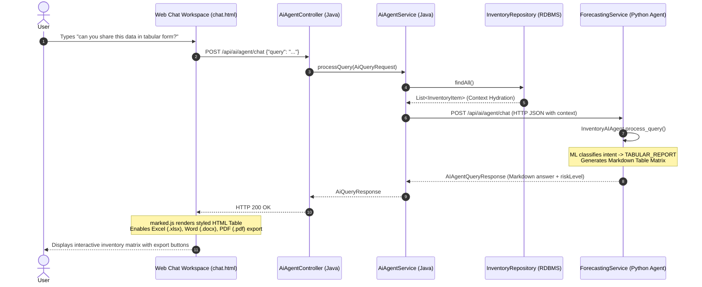
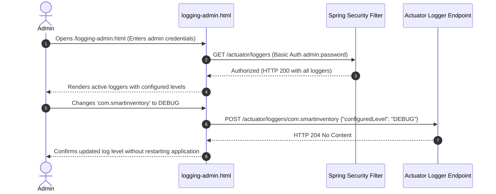

<!--
  Copyright (c) 2026 Vivek Umrao.

  Licensed under the Apache License, Version 2.0 (the "License");
  you may not use this file except in compliance with the License.
  You may obtain a copy of the License at

      http://www.apache.org/licenses/LICENSE-2.0

  Unless required by applicable law or agreed to in writing, software
  distributed under the License is distributed on an "AS IS" BASIS,
  WITHOUT WARRANTIES OR CONDITIONS OF ANY KIND, either express or implied.
  See the License for the specific language governing permissions and
  limitations under the License.
-->

# System Architecture & Engineering Guide

This document provides a detailed architectural specification and engineering blueprint of the **Smart Inventory Management System** for software engineers, DevOps leads, and enterprise architects.

---

## 🏗️ 1. High-Level System Architecture

The platform is designed as a polyglot, cloud-native microservices architecture built on **Java 17/21 (Spring Boot 3.4.1)** and **Python 3.11 (FastAPI)**.



---

## 🧩 2. Microservice Bounded Contexts & Component Responsibilities

| Microservice / Component | Bounded Context | Tech Stack | Primary Responsibilities |
| :--- | :--- | :--- | :--- |
| **`inventory-service`** | Inventory Domain | Java 17/21, Spring Boot 3.4.1, JPA, QueryDSL SQL, HikariCP, Kafka, Spring Security | Core transactional stock management, stock adjustments, audit transactions, Web Chat Workspace UI, Spring Security HTTP Basic authentication, Kafka stock event publishing, multi-database dialect abstraction, Actuator dynamic log admin. |
| **`catalog-service`** | Product Metadata Context | Java 17/21, Spring Boot 3.4.1, Spring Data MongoDB | Flexible document-based product catalog management, categories, pricing, brand metadata, and dynamic key-value specifications. |
| **`forecasting-service`** | AI & Predictive Analytics Context | Python 3.11, FastAPI, Scikit-Learn, NumPy, Pandas | ML Intent Classification, Named Entity Recognition (NER), local Human Synthesis Engine, dual-mode LLM routing, and exponential smoothing demand forecasting. |
| **`integration-tests`** | Verification Context | JUnit 5, Spring Boot Test, Testcontainers | Centralized end-to-end integration test suite validating cross-service workflows with real isolated database containers. |

---

## 🗄️ 3. Multi-Database Dialect Abstraction Framework

`inventory-service` decouples transactional business logic from underlying database engines via an extensible, 100% permissively licensed (**Apache License 2.0**) database access framework:

```text
com.smartinventory.inventory.db/
├── DatabaseType.java                 # Enum representing supported engines (POSTGRESQL, MYSQL, ORACLE, MSSQL, DB2)
├── DatabaseQueryGenerator.java       # High-level facade for query generation & JdbcTemplate execution
├── DatabaseTransactionManager.java   # Programmatic transaction boundary controller
└── dialect/                          # Polymorphic Dialect Hierarchy
    ├── QueryDialect.java             # Core dialect contract
    ├── AbstractQueryDialect.java     # Base dialect implementation with Spring JdbcTemplate & QueryDSL
    ├── QueryDialectFactory.java      # Factory selecting dialect via configuration
    ├── PostgresQueryDialect.java     # PostgreSQL dialect
    ├── MySqlQueryDialect.java        # MySQL dialect
    ├── OracleQueryDialect.java       # Oracle dialect (FETCH NEXT pagination)
    ├── SqlServerQueryDialect.java    # SQL Server dialect (OFFSET/FETCH pagination)
    └── Db2QueryDialect.java          # IBM DB2 dialect (FETCH FIRST pagination)
```

### Key Engineering Features
- **Zero Proprietary Lock-In**: Avoids non-free libraries, employing QueryDSL SQL and Spring JDBC for 100% Apache 2.0 commercial licensing compliance.
- **Dynamic Dialect Selection**: Configured via `inventory.database.type` (or `INVENTORY_DB_TYPE` environment variable) with PostgreSQL as the sensible default.
- **Programmatic Transaction Management**: [`DatabaseTransactionManager`](file:///home/user/work/Agentic-inventory/inventory-service/src/main/java/com/smartinventory/inventory/db/DatabaseTransactionManager.java) enables fine-grained programmatic transaction definitions with configurable isolation levels and `REQUIRES_NEW` propagation.

---

## 🔐 4. Enterprise Security & Role-Based Access Control (RBAC)

The security subsystem is built with Spring Security and backed by persistent relational tables:



### Authorization Rules
- Public endpoints: `/api/ai/**`, `/chat.html`, `/index.html`, `/swagger-ui/**`, `/actuator/health/**`.
- Admin-only endpoints: `/actuator/**`, `/logging-admin.html`, `/api/admin/users/**`, `/api/admin/roles`.
- Inventory write operations: Require `ROLE_ADMIN`, `ROLE_MANAGER`, or `ROLE_ENTRY_OPERATOR`.

---

## 🔍 5. Distributed Observability & Correlation ID Tracing

Both Java microservices deploy a high-precedence servlet filter ([`CorrelationIdFilter`](file:///home/user/work/Agentic-inventory/inventory-service/src/main/java/com/smartinventory/inventory/config/CorrelationIdFilter.java)):
- Captures or generates the `X-Correlation-ID` header.
- Propagates the identifier to SLF4J MDC (`Mapped Diagnostic Context`).
- Ensures all log messages across the distributed landscape carry the same trace ID.
- Returns the `X-Correlation-ID` header in HTTP responses for client-side tracing.

---

## 🔄 6. Key Workflow Sequence Diagrams

### Sequence Diagram 1: Stock Adjustment & Kafka Event Streaming


### Sequence Diagram 2: Web Chat UI AI Query Execution & Context Hydration


### Sequence Diagram 3: Dynamic Log Level Administration


---

## 🏛️ 7. SOLID & Clean Architecture Compliance

```text
com.smartinventory.inventory/
├── config/             # Configuration Layer (Spring Security, Correlation ID, Beans)
├── controller/         # Presentation Layer (REST Endpoints & Swagger Annotations)
├── db/                 # Database Persistence Layer & Transaction Control
│   └── dialect/        # QueryDialect Strategy Interfaces & Vendor SQL Implementations
├── dto/                # Data Transfer Objects (Validation & Polyglot Mapping)
├── exception/          # Centralized Exception Handling (@RestControllerAdvice)
├── kafka/              # Messaging Adapter Layer (Kafka Producer)
├── model/              # Domain Layer (JPA Entities: InventoryItem, StockTransaction, Users, Roles)
├── repository/         # Data Access Layer (Spring Data Repositories)
└── service/            # Application/Business Logic Layer
```

1. **Single Responsibility Principle (SRP)**: Controllers strictly route HTTP requests; Services encapsulate business logic; Repositories manage data access; Dialect components manage vendor-specific SQL generation.
2. **Open/Closed Principle (OCP)**: Database dialects (`com.smartinventory.inventory.db.dialect`) are open for extension without modifying existing dialect logic. DTO mappings utilize Jackson property alias annotations without breaking contracts.
3. **Liskov Substitution Principle (LSP)**: All dialect strategies extend `AbstractQueryDialect` and implement `QueryDialect` predictably.
4. **Interface Segregation Principle (ISP)**: Focused interfaces (`QueryDialect`, `InventoryRepository`, `ProductRepository`, `UserRepository`).
5. **Dependency Inversion Principle (DIP)**: Strict Spring Constructor Dependency Injection across all services, controllers, and dialect factories.

---

## 📜 8. License & Copyright

```text
Copyright (c) 2026 Vivek Umrao.

Licensed under the Apache License, Version 2.0 (the "License");
you may not use this file except in compliance with the License.
You may obtain a copy of the License at

    http://www.apache.org/licenses/LICENSE-2.0

Unless required by applicable law or agreed to in writing, software
distributed under the License is distributed on an "AS IS" BASIS,
WITHOUT WARRANTIES OR CONDITIONS OF ANY KIND, either express or implied.
See the License for the specific language governing permissions and
limitations under the License.
```
