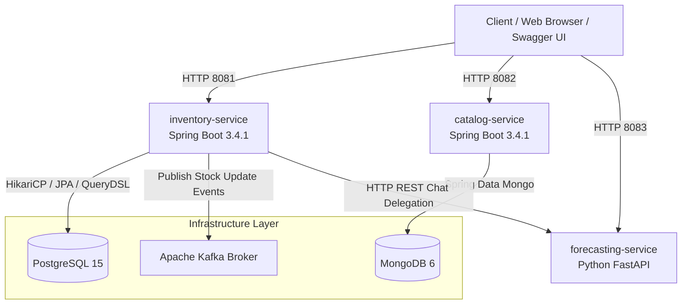
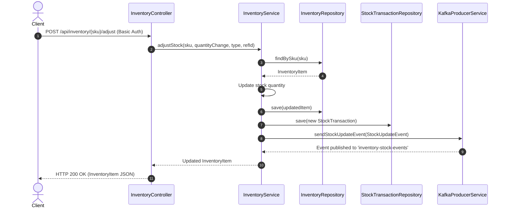
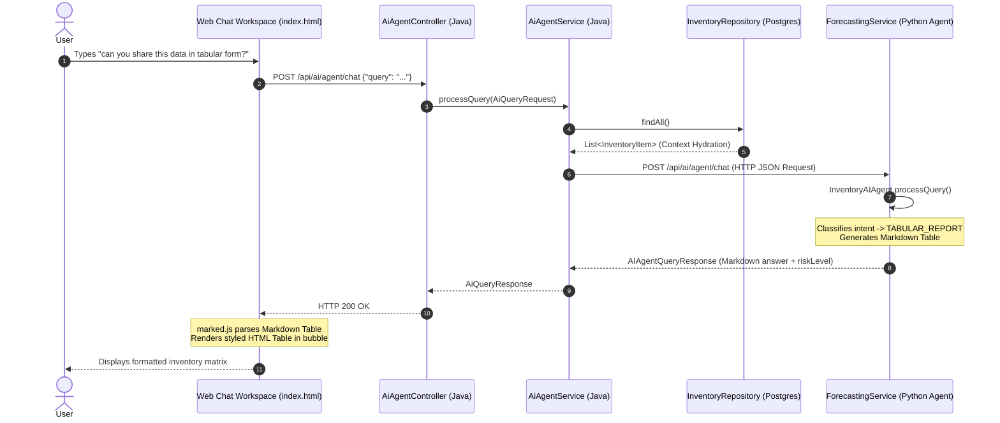

# System Architecture & Engineering Guide

This document provides a detailed technical and architectural breakdown of the **Smart Inventory Management System** for software engineers, devops leads, and system architects.

---

## 🏗️ 1. High-Level System Architecture

The system is designed as a polyglot microservices architecture built on Java 17 (Spring Boot 3.4.1) and Python 3.11 (FastAPI).



---

## 🧩 2. Microservice Bounded Contexts & Component Responsibilities

| Microservice / Component | Bounded Context | Tech Stack | Primary Responsibility |
| :--- | :--- | :--- | :--- |
| **`inventory-service`** | Inventory Domain | Java 17, Spring Boot 3.4.1, JPA, QueryDSL SQL, HikariCP, Kafka, Spring Security | Core transactional stock management, stock adjustments, audit transactions, Web Chat Workspace UI, Spring Security HTTP Basic authentication, Kafka stock event publishing, multi-database dialect abstraction. |
| **`catalog-service`** | Product Metadata Context | Java 17, Spring Boot 3.4.1, Spring Data MongoDB | Product catalog management, categories, pricing, dynamic key-value attributes. |
| **`forecasting-service`** | AI & Predictive Analytics Context | Python 3.11, FastAPI, NumPy, Pandas, Pydantic | Exponential smoothing demand projections and **Agentic AI Assistant** with Human Synthesis Engine. |
| **`integration-tests`** | Verification Context | JUnit 5, Spring Boot Test, Testcontainers | Centralized end-to-end integration test suite. |

---

## 🔄 3. Key Workflow Sequence Diagrams

### Sequence Diagram 1: Stock Adjustment & Kafka Event Publishing


### Sequence Diagram 2: Web Chat UI AI Query Execution


---

## 🏛️ 4. SOLID & Clean Architecture Compliance

```text
com.smartinventory.inventory/
├── config/             # Configuration Layer (Spring Security, Beans)
├── controller/         # Presentation Layer (REST Routers & Swagger Annotations)
├── db/                 # Database Persistence Layer & Transaction Control
│   └── dialect/        # QueryDialect Strategy Interfaces & Vendor SQL Implementations
├── dto/                # Data Transfer Objects (Validation & Polyglot Mapping)
├── exception/          # Centralized Exception Handling (@RestControllerAdvice)
├── kafka/              # Messaging Adapter Layer (Kafka Producer)
├── model/              # Domain Layer (JPA Entities)
├── repository/         # Data Access Layer (Spring Data Repositories)
└── service/            # Application/Business Logic Layer
```

1. **Single Responsibility Principle (SRP)**: Controllers strictly route HTTP requests; Services encapsulate business logic; Repositories manage database queries; Dialect components manage vendor-specific SQL generation.
2. **Open/Closed Principle (OCP)**: Database dialects (`com.smartinventory.inventory.db.dialect`) are open for extension without modifying existing dialect logic. DTO mappings utilize Jackson property alias annotations without breaking contracts.
3. **Liskov Substitution Principle (LSP)**: All dialect strategies extend `AbstractQueryDialect` and implement `QueryDialect` predictably.
4. **Interface Segregation Principle (ISP)**: Focused interfaces (`QueryDialect`, `InventoryRepository`, `ProductRepository`).
5. **Dependency Inversion Principle (DIP)**: Pure Spring Constructor Dependency Injection across all services, controllers, and dialect factories.
