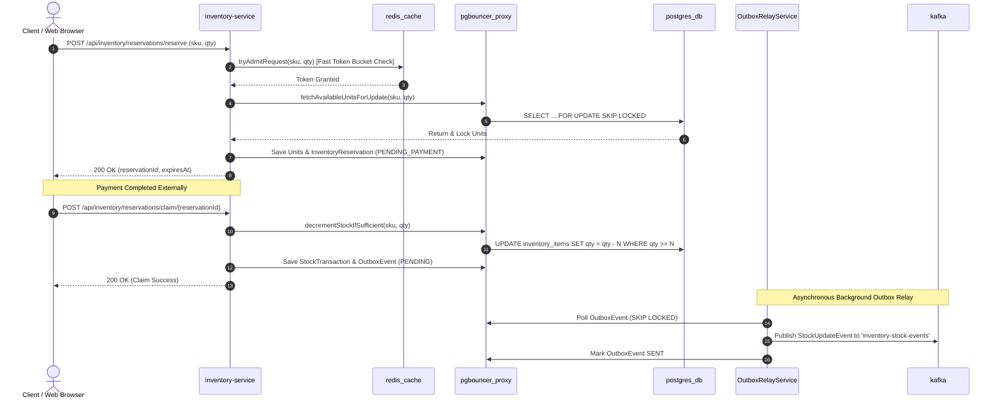
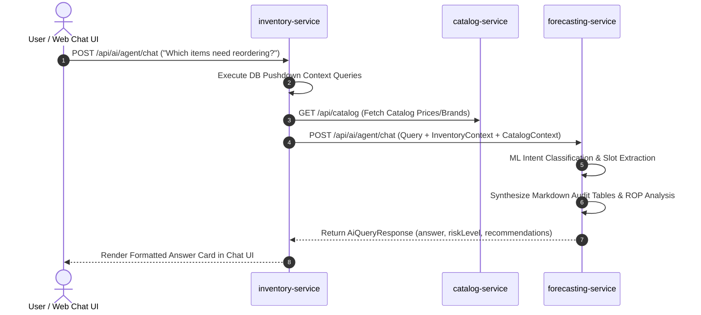
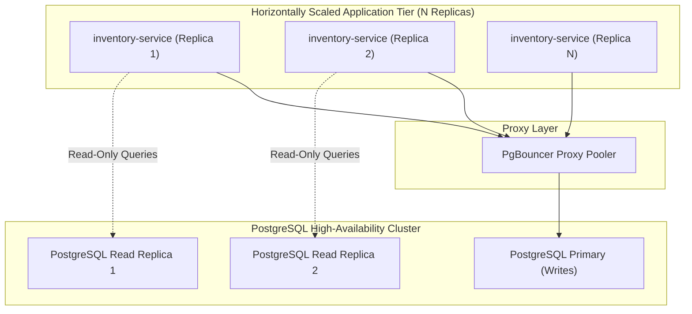

# System Container Architecture & Horizontal Expansion Guide

This document provides a comprehensive architectural guide for the **Smart Inventory Management System** running live in containerized environments (Podman, Docker Compose, and Kubernetes).

---

## 🏛️ 1. Container Topology & Architecture Diagram

```mermaid
flowchart TD
    subgraph INGRESS ["🌐 Tier 1: Client & Ingress Layer"]
        direction LR
        UI["🖥️ Web Chat UI & Admin Console<br/><code>http://localhost:8081/chat.html</code>"]
        GRAF_UI["📊 Grafana Operations Dashboard<br/><code>http://localhost:3000</code>"]
        PROM_UI["🔍 Prometheus Metrics Explorer<br/><code>http://localhost:9090</code>"]
    end

    subgraph CORE ["⚙️ Tier 2: Microservices Application Layer"]
        direction LR
        INV["📦 inventory-service<br/><i>(Java 21 / Spring Boot 3.4 / Virtual Threads)</i><br/><code>Port 8081</code>"]
        CAT["🍃 catalog-service<br/><i>(Java 21 / Spring Boot 3.4)</i><br/><code>Port 8082</code>"]
        FC["🤖 forecasting-service<br/><i>(Python 3.11 / FastAPI / Scikit-Learn)</i><br/><code>Port 8083</code>"]
    end

    subgraph DATA ["💾 Tier 3: Persistence, Caching & Proxy Layer"]
        direction LR
        PGB["⚡ pgbouncer_proxy<br/><i>(PgBouncer Connection Pooler)</i><br/><code>Port 6432</code>"]
        PG["🐘 postgres_db<br/><i>(PostgreSQL 15)</i><br/><code>Port 5432</code>"]
        MG["🍃 mongo_db<br/><i>(MongoDB 6.0)</i><br/><code>Port 27017</code>"]
        RD["⚡ redis_cache<br/><i>(Redis 7.2 Alpine)</i><br/><code>Port 6381</code>"]
    end

    subgraph PLATFORM ["📢 Tier 4 & 5: Event Bus & Observability Platform"]
        direction LR
        subgraph BUS ["📢 Event Streaming"]
            KAFKA["📨 kafka<br/><i>(Apache Kafka 7.5)</i><br/><code>Port 9092</code>"]
            ZK["🦁 zookeeper<br/><i>(Apache Zookeeper 7.5)</i><br/><code>Port 2181</code>"]
        end
        subgraph OBS ["📈 Observability & Alerts"]
            PROM["🔥 prometheus<br/><i>(Prometheus Server v2.50.0)</i><br/><code>Port 9090</code>"]
            GRAF["📈 grafana<br/><i>(Grafana Dashboard v10.3.3)</i><br/><code>Port 3000</code>"]
        end
    end

    %% Tier 1 to Tier 2 Ingress Links (Links 0, 1, 2, 3) - Cyan #38bdf8
    UI ==>|1. REST / Chat UI| INV
    UI -.->|2. REST Product Search| CAT
    GRAF_UI ==>|3. Dashboard Web UI| GRAF
    PROM_UI ==>|4. PromQL Web Console| PROM

    %% Tier 2 Microservice Interop Links (Links 4, 5) - Amber #fbbf24
    INV ==>|5. RAG Context Fetch| CAT
    INV ==>|6. ML Query Delegation| FC

    %% Tier 2 to Tier 3 Persistence Links (Links 6, 7, 8, 9) - Emerald #34d399
    INV ==>|7. Virtual Thread JDBC| PGB
    PGB ==>|8. Transaction Pooling| PG
    CAT ==>|9. Spring Data Mongo| MG
    INV ==>|10. Fast Token Check| RD

    %% Tier 2 to Tier 4 Streaming Links (Links 10, 11) - Orange #fb923c
    INV ==>|11. Transactional Outbox Relay| KAFKA
    KAFKA <==>|12. Cluster Metadata Sync| ZK

    %% Tier 2 to Tier 5 Observability Links (Links 12, 13, 14) - Purple #c084fc
    INV -.->|13. Scrape /actuator/prometheus| PROM
    CAT -.->|14. Scrape /actuator/prometheus| PROM
    GRAF ==>|15. PromQL Datasource| PROM

    %% Node Styling
    classDef ingressStyle fill:#0f172a,stroke:#38bdf8,stroke-width:2px,color:#f8fafc;
    classDef appStyle fill:#1e1b4b,stroke:#818cf8,stroke-width:2px,color:#f8fafc;
    classDef dataStyle fill:#064e3b,stroke:#34d399,stroke-width:2px,color:#f8fafc;
    classDef busStyle fill:#451a03,stroke:#fb923c,stroke-width:2px,color:#f8fafc;
    classDef obsStyle fill:#311042,stroke:#c084fc,stroke-width:2px,color:#f8fafc;

    class UI,GRAF_UI,PROM_UI ingressStyle;
    class INV,CAT,FC appStyle;
    class PGB,PG,MG,RD dataStyle;
    class KAFKA,ZK busStyle;
    class PROM,GRAF obsStyle;

    %% Color-Coded Arrow Lines
    linkStyle 0,1,2,3 stroke:#38bdf8,stroke-width:2px;
    linkStyle 4,5 stroke:#fbbf24,stroke-width:2px;
    linkStyle 6,7,8,9 stroke:#34d399,stroke-width:2px;
    linkStyle 10,11 stroke:#fb923c,stroke-width:2px;
    linkStyle 12,13,14 stroke:#c084fc,stroke-width:2px;
```



---

## 📦 2. Container Roles & Technology Matrix

| Container Name | Image & Technology | Host Port | Primary Responsibilities & Architectural Role |
| :--- | :--- | :---: | :--- |
| **`inventory-service`** | Java 21 / Spring Boot 3.4 / Virtual Threads | `8081` | **Core Transactional Engine & User Interface**: Handles flash-sale reservations via `FOR UPDATE SKIP LOCKED`, atomic master ledger deductions, state machine transitions (`PENDING_PAYMENT`, `COMPLETED`, `FAILED`, `EXPIRED`), Spring Security RBAC, transactional outbox event relaying, Web Chat UI (`/chat.html`), and Runtime Logging Admin (`/logging-admin.html`). |
| **`catalog-service`** | Java 21 / Spring Boot 3.4 / MongoDB | `8082` | **Product Catalog Manager**: Manages product documents, dynamic technical specifications, brands, categories, tags, and pricing. |
| **`forecasting-service`** | Python 3.11 / FastAPI / Scikit-Learn | `8083` | **AI Agent & Demand Forecasting Engine**: Runs Scikit-Learn ML intent classification, NER slot extraction, Holt-Winters exponential smoothing, statistical safety stock ($Z=1.65$), and human-like markdown synthesis. |
| **`grafana`** | Grafana (`grafana/grafana:10.3.3`) | `3000` | **Visual Operations Dashboards**: Pre-configured with Prometheus datasource and live operational dashboards (`Smart Inventory - Live Operations & Concurrency Dashboard`) for monitoring reservation throughput, memory usage, and outbox lag. |
| **`prometheus`** | Prometheus (`prom/prometheus:v2.50.0`) | `9090` | **Metrics Collector & Alert Manager**: Scrapes `/actuator/prometheus` metrics endpoints every 5s and evaluates multi-window burn-rate SLO rules (`alerts.yml`). |
| **`pgbouncer_proxy`** | PgBouncer (`edoburu/pgbouncer`) | `6432` | **Database Connection Proxy**: Operates in `transaction` pooling mode, multiplexing hundreds of incoming Virtual Thread application connections down to a fixed, efficient pool (e.g., 20 connections) on PostgreSQL. |
| **`postgres_db`** | PostgreSQL 15 | `5432` | **ACID Relational Source of Truth**: Stores stock items, reservation units, reservation headers, movement transactions, outbox events, Flyway migration history (`flyway_schema_history`), and user/role credentials. |
| **`mongo_db`** | MongoDB 6.0 | `27017` | **Document Store**: Stores flexible, schema-less product catalog documents and dynamic key-value specifications. |
| **`redis_cache`** | Redis 7.2 Alpine | `6381` | **Admission Gate & Cache**: Fast-path token bucket admission control gate for flash-sale SKUs and resilient catalog query cache. |
| **`kafka`** | Apache Kafka 7.5 (Confluent) | `9092` | **Event Streaming Platform**: Asynchronous event log broker publishing `inventory-stock-events` for downstream analytics and external systems. |
| **`zookeeper`** | Apache Zookeeper 7.5 | `2181` | **Cluster Coordinator**: Manages topic partition leader elections, broker cluster state, and metadata for Kafka. |

---

## 🔄 3. End-to-End Service Interaction Flows

### A. High-Concurrency Flash Sale Reservation & Claim Flow



### B. AI Agent Chat & Demand Forecasting Flow



---

## ⚡ 4. Horizontal Expansion & Scaling Strategies



### **1. Stateless Microservices Expansion ($N$ Replicas)**
* **`inventory-service`**:
  * **Scaling Mechanism**: Scale to $N$ replicas via Kubernetes `HorizontalPodAutoscaler` (`minReplicas: 2, maxReplicas: 10`) or `podman compose up --scale inventory-service=5`.
  * **Stateless Design**: All instances share no in-memory state. Concurrent reservation locks are managed by PostgreSQL `FOR UPDATE SKIP LOCKED`, background reapers use set-based atomic SQL queries, and database connection limits are enforced by **PgBouncer**.
* **`catalog-service`**:
  * Scale to $N$ instances behind an Ingress/Load Balancer.
* **`forecasting-service`**:
  * Scale to $N$ instances or increase worker concurrency (`uvicorn --workers 4`). ML classification and statistical forecasting scale linearly across CPU cores.

### **2. Database & Connection Proxy Scaling**
* **PgBouncer Transaction Pooling**:
  * Prevents connection pool exhaustion on PostgreSQL by multiplexing thousands of incoming application Virtual Thread JDBC connections into a fixed pool of server connections.
* **PostgreSQL Primary/Replica Split**:
  * Write transactions (`reserveStock`, `claimReservation`, `outbox`) execute on the Primary node.
  * Read-only analytical queries (AI context aggregation, catalog valuations, reporting) execute on Read Replicas.

### **3. Kafka Event Partitioning**
* Increase topic partitions for `inventory-stock-events` ($P=10$). Up to $P$ concurrent `inventory-service` instances in consumer group `inventory-service-audit-group` consume events in parallel without message duplication.

### **4. Independent Database Migration & Data Seeding Tool**
* **Decoupled Lifecycle**: Database schema evolution (Flyway DDL) and initial reference data seeding are completely decoupled from runtime microservices.
* **Standalone Tool**: [`MigrationSeederTool`](file:///H:/GitHubProjects/AgenticInventory/inventory-service/src/main/java/com/smartinventory/inventory/tool/MigrationSeederTool.java) reads properties from a dedicated config file ([`config/seeder-migration.properties`](file:///H:/GitHubProjects/AgenticInventory/config/seeder-migration.properties)) or environment variables.
* **InitContainer & CLI Usage**: Can be executed independently in CI/CD pipelines, as a Kubernetes InitContainer / Job, or via CLI scripts:
  ```bash
  # Standalone CLI Execution
  ./scripts/run_migration_seeder.sh config/seeder-migration.properties all
  ```

---

## 🛠️ 5. Health & Observability Verification Commands

Verify the live running status of all containers and observability dashboards:

```bash
# Check container status
podman ps

# Verify microservices health
curl -s http://localhost:8081/actuator/health   # inventory-service
curl -s http://localhost:8082/actuator/health   # catalog-service
curl -s http://localhost:8083/health            # forecasting-service

# Verify Observability Stack
curl -s http://localhost:9090/-/healthy         # Prometheus Server (UI: http://localhost:9090)
curl -s http://localhost:3000/api/health        # Grafana Dashboard (UI: http://localhost:3000, admin/admin)
```
