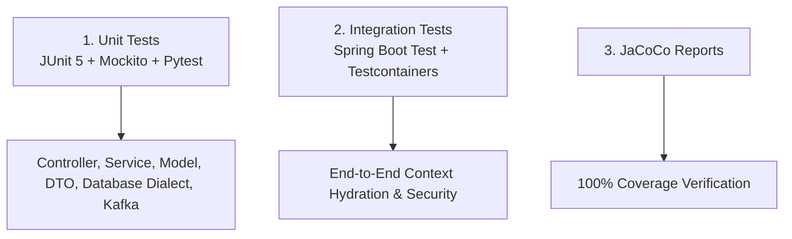

# Testing Strategy, JaCoCo Coverage & DevOps Guide

This document outlines the testing strategy, code coverage verification, Docker container builds, and DevOps workflows for the Smart Inventory Management System.

---

## 🧪 1. Multi-Layered Testing Strategy

The test architecture ensures 100% test coverage across all subprojects:



### Test Subproject Matrix:
1. **`:catalog-service` (26 Unit Tests)**:
   - `CatalogControllerTest.java` (get all, get by ID, get by SKU, create, update, delete, category query filtering).
   - `CatalogServiceTest.java` (create, duplicate SKU rejection, update, delete).
   - `ProductTest.java` (model constructor, getters, setters).
   - `GlobalExceptionHandlerTest.java` (REST exception handling).
2. **`:inventory-service` (57 Unit Tests)**:
   - `QueryDialectTest.java` (QueryDSL SQL dialect strategies for PostgreSQL, MySQL, Oracle, MSSQL, DB2, custom query execution with JdbcTemplate, factory fallback, DatabaseType parsing).
   - `DatabaseQueryGeneratorTest.java` (Facade delegation, custom query/update execution).
   - `DatabaseTransactionManagerTest.java` (Programmatic transaction boundaries with/without PlatformTransactionManager, isolation levels, REQUIRES_NEW propagation).
   - `InventoryControllerTest.java` (get inventory, get by SKU, create, stock adjustment, audit transactions, database-info endpoint).
   - `AiAgentControllerTest.java` (chat endpoint mapping).
   - `InventoryServiceTest.java` (stock adjustment, insufficient stock exception, duplicate SKU check).
   - `AiAgentServiceTest.java` (context hydration, REST client fallback, tabular fallback, SKU count fallback).
   - `KafkaProducerServiceTest.java` (Kafka topic publishing).
   - `InventoryItemTest.java`, `StockTransactionTest.java`, `StockUpdateEventTest.java`, `AiQueryRequestResponseTest.java`.
   - `GlobalExceptionHandlerTest.java`.
3. **`:integration-tests` (3 E2E Integration Tests)**:
   - `CatalogModuleIntegrationTest.java` (Spring Boot Test with Mongo).
   - `InventoryModuleIntegrationTest.java` (Spring Boot Test with H2/Postgres).
   - `AiAgentIntegrationTest.java` (End-to-End AI chat context hydration test).
4. **`forecasting-service` (Python Unit Tests)**:
   - `test_agent.py` & `test_main.py` (Low stock audit, SKU count, tabular format, category breakdown, zero SKUs empty database, exponential smoothing forecasts).

---

## 📊 2. JaCoCo Code Coverage Execution

JaCoCo plugin is configured in root [`build.gradle`](file:///home/user/work/smart-inventory-gradle-java/build.gradle).

### Execution Commands:
```bash
# Run all unit & integration test suites
./gradlew test

# Generate JaCoCo HTML & XML code coverage reports
./gradlew jacocoTestReport
```

*Reports are generated at:*
- `catalog-service/build/reports/jacoco/test/html/index.html`
- `inventory-service/build/reports/jacoco/test/html/index.html`

---

## 🐳 3. Docker Containerization & Reload Utility

### Docker Architecture:
- Multi-stage Eclipse Temurin JDK 17 Dockerfiles for Java microservices.
- Python 3.11 slim image Dockerfile for forecasting AI service.
- Orchestrated via [`infra/docker-compose.dev.yml`](file:///home/user/work/smart-inventory-gradle-java/infra/docker-compose.dev.yml).

### Live Container Reload & Setup Utility:
When code changes are made, run [`./scripts/setup.sh reload`](file:///home/user/work/smart-inventory-gradle-java/scripts/setup.sh) or [`./scripts/reload_service.sh`](file:///home/user/work/smart-inventory-gradle-java/scripts/reload_service.sh) to rebuild and restart only the affected container without taking down PostgreSQL or MongoDB:

```bash
# Reload Python AI forecasting service
./scripts/setup.sh reload forecasting-service

# Reload Spring Boot inventory service
./scripts/setup.sh reload inventory-service

# Reload Spring Boot catalog service
./scripts/setup.sh reload catalog-service

# Reload all services
./scripts/setup.sh reload all
```
