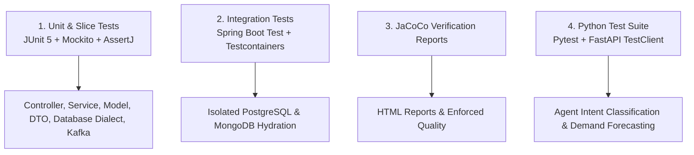

<!--
  Copyright (c) 2026 Vivek Umrao.

  Licensed under the Apache License, Version 2.0 (the "License");
  you may not use this file except in compliance with the License.
  You may obtain a copy of the License at

      http://www.apache.org/licenses/LICENSE-2.0

  Unless required by applicable law or agreed to in writing, software
  distributed under the License is distributed on an "AS IS" BASIS,
  WITHOUT WARRANTIES OR CONDITIONS OF ANY KIND, either express or implied.
  See the License for the specific language governing permissions and
  limitations under the License.
-->

# Testing Strategy, JaCoCo Coverage & DevOps Guide

This document outlines the testing architecture, code coverage verification, Docker container builds, and DevOps workflows for the Smart Inventory Management System.

---

## 🧪 1. Multi-Layered Testing Strategy

The test architecture ensures high test coverage across all subprojects:



### Test Subproject Matrix:

1. **`:catalog-service`**:
   - `CatalogControllerTest.java`: REST mapping, query validation, category filtering, exception propagation.
   - `CatalogServiceTest.java`: Business logic, duplicate SKU collision prevention, CRUD operations.
   - `ProductTest.java`: Model constructors, immutability, JSON property mappings.
   - `GlobalExceptionHandlerTest.java`: Error response contracts, HTTP status code bindings.
   - `CatalogActuatorLoggerTest.java`: Actuator dynamic logging endpoints.

2. **`:inventory-service`**:
   - `QueryDialectTest.java`: SQL dialect strategies for PostgreSQL, MySQL, Oracle, MSSQL, and DB2; custom query rendering with `JdbcTemplate`; fallback mechanisms; `DatabaseType` parsing.
   - `DatabaseQueryGeneratorTest.java`: Facade delegation and custom query execution.
   - `DatabaseTransactionManagerTest.java`: Programmatic transaction boundaries, custom isolation levels, and `REQUIRES_NEW` propagation.
   - `InventoryControllerTest.java`: Inventory retrieval, SKU lookups, create item, stock adjustment, audit log transactions, database-info endpoint.
   - `AiAgentControllerTest.java`: Chat endpoint mapping, DTO conversion, and error handling.
   - `InventoryServiceTest.java`: Stock adjustment arithmetic, insufficient stock validation, duplicate SKU prevention.
   - `AiAgentServiceTest.java`: Live context hydration, REST client fallbacks, tabular formatting fallback, SKU count fallback.
   - `KafkaProducerServiceTest.java` & `StockUpdateEventTest.java`: Kafka event formatting and topic publishing.
   - `InventoryItemTest.java`, `StockTransactionTest.java`, `AiQueryRequestResponseTest.java`: Entity and DTO validation.
   - `InventoryActuatorLoggerTest.java`: Actuator logger inspection and modification.
   - `GlobalExceptionHandlerTest.java`: Centralized exception translation.

3. **`:integration-tests`**:
   - `CatalogModuleIntegrationTest.java`: Full Spring Boot context hydration with real Testcontainers MongoDB.
   - `InventoryModuleIntegrationTest.java`: Full Spring Boot context hydration with real Testcontainers PostgreSQL.
   - `AiAgentIntegrationTest.java`: End-to-end AI chat context hydration test verifying end-to-end data assembly.

4. **`forecasting-service`**:
   - `test_agent.py`: Low stock audit, SKU count, tabular format, category breakdown, zero SKUs empty database handling, entity extraction.
   - `test_main.py`: Exponential smoothing forecasts, safety stock calculations, dynamic reorder point math, anomaly detection.

---

## 📊 2. Code Coverage with JaCoCo

JaCoCo is configured across all Gradle subprojects.

### Generating Coverage Reports
Run the unified test task:
```bash
./gradlew test jacocoTestReport
```

Reports are output to:
- `catalog-service/build/reports/jacoco/test/html/index.html`
- `inventory-service/build/reports/jacoco/test/html/index.html`
- `integration-tests/build/reports/jacoco/test/html/index.html`

---

## 🐳 3. Containerization & Production Dockerfiles

All microservices utilize production-hardened Dockerfiles with non-root security contexts:
- **Base Images**:
  - Java: `eclipse-temurin:17-jre-jammy`
  - Python: `python:3.11-slim`
- **Security Hardening**:
  - Runs as unprivileged user `appuser` (UID `10001`, GID `appgroup`).
  - No secrets baked into layers.
  - Multi-stage dependency caching.
- **Docker Compose Profiles**:
  - `postgres` (default)
  - `mysql`
  - `mssql`
  - `oracle`
  - `db2`

---

## 🛠️ 4. Unified DevOps Scripts

The project includes pre-built DevOps management scripts:
- [`scripts/setup.sh`](file:///home/user/work/Agentic-inventory/scripts/setup.sh):
  - `./scripts/setup.sh fresh [db_type]` — Tear down, reconfigure DB, compile, start containers, and seed data.
  - `./scripts/setup.sh up [db_type]` — Start existing environment.
  - `./scripts/setup.sh destroy` — Stop and remove containers (preserves DB volumes).
  - `./scripts/setup.sh clean` — Wipe all containers, networks, volumes, local images, and `.env`.
  - `./scripts/setup.sh reload [service|all]` — Hot-reload code into containers without stopping databases.
  - `./scripts/setup.sh seed` — Seed sample catalog and inventory data.
- [`scripts/reload_service.sh`](file:///home/user/work/Agentic-inventory/scripts/reload_service.sh):
  - Fast single-service container rebuilder.
- [`scripts/seed_data.py`](file:///home/user/work/Agentic-inventory/scripts/seed_data.py):
  - Procedural database seeder populating users, roles, 10 catalog items, and 10 inventory items.
- [`scripts/generate_training_data.py`](file:///home/user/work/Agentic-inventory/scripts/generate_training_data.py):
  - Generates 1,700+ balanced intent classification samples and 350+ instruction-tuning dialogues.

---

## 📜 5. License & Copyright

```text
Copyright (c) 2026 Vivek Umrao.

Licensed under the Apache License, Version 2.0 (the "License");
you may not use this file except in compliance with the License.
You may obtain a copy of the License at

    http://www.apache.org/licenses/LICENSE-2.0

Unless required by applicable law or agreed to in writing, software
distributed under the License is distributed on an "AS IS" BASIS,
WITHOUT WARRANTIES OR CONDITIONS OF ANY KIND, either express or implied.
See the License for the specific language governing permissions and
limitations under the License.
```
